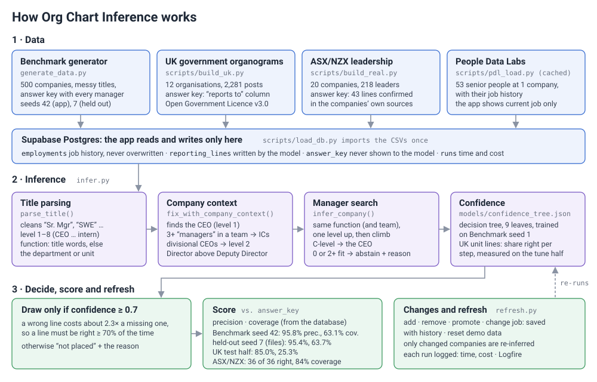
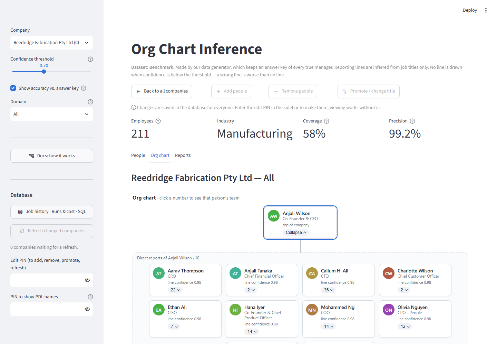
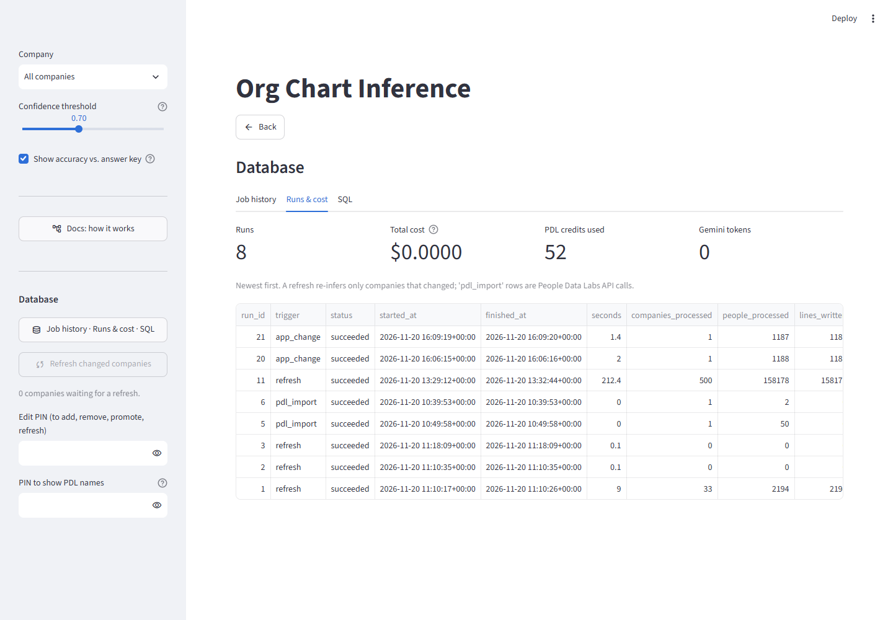
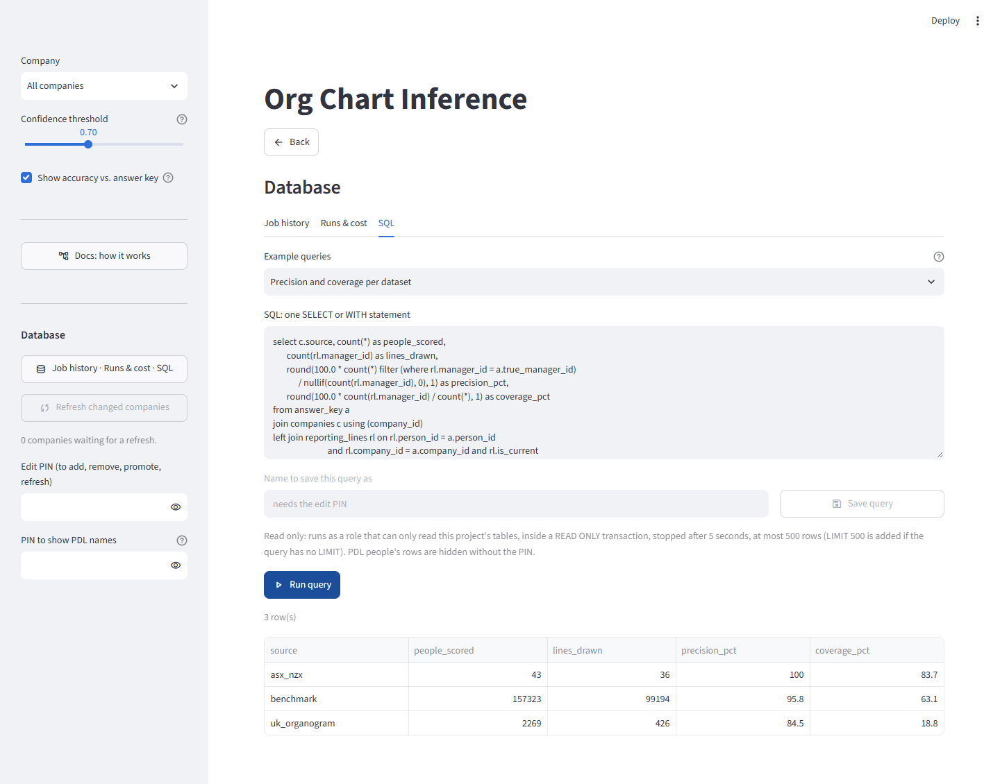

# Org Chart Inference

Turns a flat list of people and job titles into an org chart, with a confidence on every
reporting line. It leaves the manager blank, with a reason, when it isn't sure. Everything
lives in a Postgres database, and every change keeps its history.

**Live app:** https://divya-org-chart.streamlit.app
*(Free hosting sleeps when idle. If you see "Yes, get this app back up!", click it and wait
a minute.)*


## What it does

- **Infers who reports to whom** for every organisation, from names, job titles and (if
  given) a department or unit. It never sees the real reporting lines.
- **Gives every line a confidence** and draws it only at 0.7 or above, because a wrong line
  is worse than no line. Everyone without a line is listed with the reason.
- **Measures itself** against an answer key on three datasets: 500 generated companies, 20
  real ASX/NZX leadership teams and 12 real UK government organisations.
- **Keeps a history:** people can be added, removed, promoted or moved to another company
  in the app. Each change is saved with its history, and only the companies that changed
  are worked out again.
- **Lets you query the data:** job history, runs and their cost, and read-only SQL, all in
  the app.

## How it works



1. **Title parsing.** Each title is cleaned ("Sr. Mgr" → "senior manager") and read into a
   **level** (1 = CEO … 8 = intern), a **function** (Engineering, Sales …) and a **team**.
   UK civil-service titles have their own ladder: Permanent Secretary > Director General >
   Director > Deputy Director.
2. **Company context.** The rest of the company fixes single titles:
   - it finds the CEO;
   - a team or unit name fills in a missing function;
   - 3+ "managers" in one team are really individual contributors;
   - a divisional CEO sits below the group CEO.
3. **Manager search.** It looks one level up in the same function (and team), then climbs.
   If nobody fits, or several people do, it **abstains** and saves the reason.
4. **Confidence tree + threshold 0.7.** A small decision tree (9 readable leaves, trained on a
   separate dataset) scores each proposed line. A line is drawn only at **confidence ≥ 0.7**:
   a wrong line costs about **2.3×** a missing one, so a line is worth drawing when it is
   right at least 70% of the time (2.3 / 3.3 ≈ 0.7).

The rules are in `infer.py`. `refresh.py` runs them on the database.

## Database

A free **Supabase Postgres** database. The app reads and writes **only** the database. The
CSV files are used once, to import the source data (`scripts/load_db.py`).

| Table | One row is … |
|---|---|
| `companies` | a company or organisation; `needs_refresh` = its chart is out of date |
| `people` | a person (once, even after moving between companies) |
| `employments` | one job: person, company, title, start and end date, `is_current`, `change_type` |
| `reporting_lines` | a person's inferred manager in one refresh: confidence, reason, judge |
| `answer_key` | a person's true manager, only for measuring; the model never reads it |
| `runs` | one refresh or PDL call: time, companies and people, PDL credits, Gemini tokens, cost |
| `sources` | where each real company or organisation comes from (link, date, licence) |
| `change_log` | one change made in the app: which job rows it opened and closed (for undo) |
| `saved_queries` | queries saved from the app's SQL tab |

- **History is never overwritten.** A title change or a move **closes** the old job (end
  date, `is_current = false`) and **opens** a new one, linked to the old one. Undo reopens
  the old row.
- **Size:** about 128 MB of the free 500 MB.
- **Details:** `db/schema.sql` and `db/migrations/`; [db/README.md](db/README.md) explains
  every table.

## Data sources

| Source | Companies | People | Answer key (people with a known manager) |
|---|---|---|---|
| **Benchmark** (generated, seed 42) | 500 | 157,823 | 157,323 |
| **ASX/NZX leadership** (real) | 20 | 218 | 43 lines confirmed in writing |
| **UK government organograms** (real) | 12 | 2,281 | 2,269 |
| **People Data Labs** (real) | 1 current + 233 past employers | 50 | none |

- **Benchmark:** made by `generate_data.py`, with realistic messy titles (abbreviations,
  missing teams, two-manager teams, missing managers …). The generator writes the answer key.
- **ASX/NZX leadership:** names and job titles copied from each company's own leadership
  page (checked 14 Nov 2026). The small answer key comes from the companies' own written
  sources (announcements, annual reports, governance statements). See [Sources](#sources).
- **UK government organograms:** the senior-staff organograms 12 UK government bodies
  publish on [data.gov.uk](https://www.data.gov.uk/) (downloaded 16 Nov 2026; raw files in
  `data/raw/uk/`). The published "Reports to Senior Post" column is the answer key; the model
  never sees it, nor grade or salary. Contains public sector information licensed under the
  [Open Government Licence v3.0](https://www.nationalarchives.gov.uk/doc/open-government-licence/version/3/).
- **People Data Labs (PDL):** one call to PDL's free person search API returned 50 senior
  people (C-level, VP, director) at one company, each with their job history.
  - **History:** 486 jobs: 272 company changes and 164 title changes.
  - **Credits:** 52 of the free plan's ~100 a month, test call included.
  - **Stored:** only the needed fields (name, title, company, dates, department,
    seniority). No emails, phone numbers, social links or addresses, in the database or
    in the local cache.
  - **Cached:** responses are cached in `data/pdl/cache/` (not in git), so a rerun never
    spends credits.
  - **Terms:** the person data is used under PDL's terms. PDL's separate free company
    dataset is [CC BY 4.0](https://docs.peopledatalabs.com/docs/free-company-dataset) but
    isn't used here.
  - **Privacy:** they are real people, so the app shows their names only with the view
    PIN.

## Changes and refresh

- **Add, remove, promote / change title and change job** are saved in the database with
  history (`db/changes.py`). "New organisation" creates a company with source `manual`.
- **Every change marks the affected companies** `needs_refresh`. A move marks both the old
  and the new company.
- **"Refresh changed companies"** (sidebar) re-infers **only** those companies and saves
  their new lines. Everything else stays as it is. Example: one move between two companies
  refreshes 2 of 533 companies in about 2 seconds.
- **Undo last change** reverses the newest saved change and marks its companies for refresh.
- **Before vs Now** (Reports tab) compares a company's previous refresh with the latest one.
- **Cleanup:** for each company, only the lines of its **last 2 refreshes** are kept.
  Employment history is never deleted.

| Org chart (C001) | Runs & cost |
|---|---|
|  |  |

## Cost and logging

- **`runs` table:** every refresh and every PDL call is a row with start and end time,
  companies and people processed, lines written, PDL credits, Gemini calls and tokens, and
  cost in USD. The app's **Runs & cost** tab shows the totals and every run.
- **Prices** are kept in one place, `db/costs.py`, with their source link:
  - the rules cost $0;
  - Gemini is costed at its list price per token;
  - PDL credits are $0 on the free plan.
- **Total so far:** $0. 52 PDL credits used, 0 Gemini tokens.
- **Logfire:** each refresh sends one span per run and one per company: people processed,
  lines drawn, not placed, time, judge and cost. **Only IDs and counts are sent, never
  names or titles.** Without a `LOGFIRE_TOKEN` everything still works, without logging.

## Query the data

Sidebar → **Database**:

- **Job history:** pick a person and see every job in order: company, title, dates, and
  whether it was a title change or a job change.
- **Runs & cost:** the totals, then every run.
- **SQL:** one `SELECT` or `WITH` statement. It runs as a **read-only database role**, inside
  a **read-only transaction**, is stopped after **5 seconds**, and gets **LIMIT 500** if it
  has none. A dropdown has 8 example queries, plus queries saved with **Save query** (needs
  the edit PIN).



Three examples:

```sql
-- One person's job history
select c.name as company, e.title, e.start_date, e.end_date, e.change_type
from employments e join companies c using (company_id)
where e.person_id = 'C001-E0002'
order by e.start_date nulls first, e.employment_id;

-- A company's current org chart
select p.full_name, m.full_name as manager, rl.confidence, rl.reason
from reporting_lines rl
join people p      on p.person_id = rl.person_id
left join people m on m.person_id = rl.manager_id
where rl.company_id = 'C001' and rl.is_current;

-- Precision and coverage per dataset
select c.source, count(*) as people_scored, count(rl.manager_id) as lines_drawn,
       round(100.0 * count(*) filter (where rl.manager_id = a.true_manager_id)
             / nullif(count(rl.manager_id), 0), 1) as precision_pct,
       round(100.0 * count(rl.manager_id) / count(*), 1) as coverage_pct
from answer_key a
join companies c using (company_id)
left join reporting_lines rl on rl.person_id = a.person_id
                            and rl.company_id = a.company_id and rl.is_current
where a.true_manager_id is not null
group by c.source;
```

## Safety and privacy

- **View PIN (`DB_VIEW_PIN`):** without it, PDL people (real people) show as
  "PDL person #id" everywhere:
  - in the charts and tables;
  - in Job history, where they can't be found by name;
  - in SQL, where their rows are hidden.
- **Edit PIN (`DB_EDIT_PIN`):** needed to add, remove, promote, refresh, undo or save a
  query. Without it the buttons are disabled; viewing works for everyone.
- **SQL tab:** a read-only role that can only read this project's tables. It can't see
  Supabase's own schemas (such as `auth` or `vault`), and queries that try to switch roles
  are refused.
- **Supabase's public web API is blocked:** row level security is on for every table.
- **Secrets** live only in `.streamlit/secrets.toml` (git-ignored) locally and in Streamlit
  Cloud → Settings → Secrets when deployed. They are never in git, never printed and never
  logged.

## Results

Threshold 0.7, from the database (current reporting lines vs. `answer_key`).
**Precision** = of the lines drawn, the share that are right. **Coverage** = the share of
people with a known manager who got a line.

| Dataset | Precision | Coverage |
|---|---|---|
| Benchmark seed 42 (500 companies) | 95.8% | 63.1% |
| Benchmark seed 7 (**held out**, never looked at; measured from files) | 95.4% | 63.7% |
| ASX/NZX (43 confirmed lines) | 100% (36 of 36) | 83.7% |
| UK, tune half (UK fixes designed here) | 83.6% | 12.6% |
| UK, **test half** (never looked at) | 85.0% | 25.3% |

- **The same Benchmark scores 95.2% / 62.7% from the CSV files.** The rules are the same;
  the difference is duplicate rows (`-DUP`). In the CSVs, 581 lines point at a duplicate
  copy of the right manager and are counted as wrong. The database has only the original
  IDs. Details: [docs/experiments.md](docs/experiments.md) (E8, E9).
- **The confidence is honest:** lines scored ~0.8 are right ~80% of the time.
- **PDL:** no answer key. Only senior people were fetched, so most of their managers are
  missing; the rules abstain for all 50 rather than guess.

### Rules vs Gemini judge

As an option, Gemini can place a person instead of the rules. It gets the person's name,
title and unit, plus at most 8 candidate managers chosen by the rules: never the whole
company, never the answer key. In the app, the choice is made per change, and Gemini runs
at the next refresh; its tokens and cost go into that run.

Measured once on small samples ([docs/judge_comparison.md](docs/judge_comparison.md),
`gemini-3.5-flash-lite`, threshold 0.7):

| Dataset | Judge | People | Lines drawn | Right | Precision | Coverage |
|---|---|---|---|---|---|---|
| Benchmark seed 7 (held out) | Rules | 50 | 34 | 34 | 100.0% | 68.0% |
| Benchmark seed 7 (held out) | Gemini | 50 | 33 | 32 | 97.0% | 66.0% |
| UK test half | Rules | 50 | 21 | 16 | 76.2% | 42.0% |
| UK test half | Gemini | 50 | 27 | 19 | 70.4% | 54.0% |
| ASX/NZX (all with an answer) | Rules | 43 | 36 | 36 | 100.0% | 83.7% |
| ASX/NZX (all with an answer) | Gemini | 43 | 43 | 42 | 97.7% | 100.0% |

- **Gemini's ceiling:** it can only pick the true manager if that person is on its short
  list. That happened for 72% of the Benchmark sample and 56% of the UK sample.
- **Rules stay the default:**
  - Gemini had lower precision on every dataset;
  - the rules are free and instant, give the same answer every time, and give a reason
    for each line.

### Limits

- **Small answer keys for real data:** ASX/NZX has only 43 confirmed lines, all from the
  top layer. UK files stop at Deputy Director level.
- **The Benchmark is generated by our own code.** The held-out seed shares its recipe, which
  is why the real datasets matter.
- **PDL:** 50 senior people at one company, no answer key. The free plan's ~100 credits a
  month can't fill companies of 100+ people.
- **Still hard:** teams with two managers, managers missing from the data, and dotted lines
  (detected, but never drawn).
- **Free tiers:**
  - Supabase pauses a project after about a week with no activity; the app then says
    "Database not connected" until it is resumed.
  - Gemini's free tier allows only a few requests a day.

## Run it locally

Windows, Python 3.13; versions are pinned in `requirements.txt`.

```
python -m venv .venv
.venv\Scripts\activate
pip install -r requirements.txt
```

**1. Secrets.** In `.streamlit/secrets.toml` (git-ignored), names only:

| Name | Needed for |
|---|---|
| `DATABASE_URL` | the database (Supabase session pooler address, with `[YOUR-PASSWORD]` in it) |
| `DATABASE_PASSWORD` | the database |
| `DB_EDIT_PIN` | optional: making changes in the app |
| `DB_VIEW_PIN` | optional: showing PDL people's names |
| `LOGFIRE_TOKEN` | optional: logging |
| `GEMINI_API_KEY` | optional: the Gemini judge |
| `PDL_API_KEY` | only for `scripts/pdl_load.py` when its cache is missing |

**2. Database tables**, in this order:

```
python scripts/run_sql.py db/schema.sql
python scripts/run_sql.py db/migrations/001_pdl_history.sql
python scripts/run_sql.py db/migrations/002_manual_changes.sql
python scripts/run_sql.py db/migrations/003_costs.sql
python scripts/run_sql.py db/migrations/004_trigger_once.sql
python scripts/run_sql.py db/migrations/005_app_reads.sql
python scripts/run_sql.py db/migrations/006_app_changes.sql
python scripts/check_db.py              # version, tables and row counts
```

`db/schema.sql` creates the tables, so run it only once, on an empty database. The
migrations are safe to run again.

**3. Source data, imported once:**

```
python generate_data.py                 # Benchmark CSVs (data/)
python scripts/build_real.py            # ASX/NZX leaders + sources
python scripts/build_real_truth.py      # ASX/NZX answer key
python scripts/build_uk.py              # UK, offline from data/raw/uk/
python scripts/load_db.py               # everything above into the database (COPY, safe to rerun)
python scripts/pdl_load.py              # PDL people from data/pdl/cache/ (calls PDL only if the cache is missing: spends credits)
python scripts/pdl_record_runs.py       # the PDL calls as runs rows (credits)
```

**4. Infer, then start the app:**

```
python refresh.py                       # infers every company that needs it, logs a run
streamlit run app.py
```

**Tests:**
- `python scripts/test_app.py` (read only)
- `python scripts/test_app_changes.py` (adds, refreshes and undoes changes, then puts the
  database back exactly as it was)
- `python scripts/compare_db_csv.py` (database vs CSV results)

The CSV pipeline (`infer.py`, `evaluate.py`, held-out seed 7) still runs on files for
measuring.

**Project structure (main files):**

| File | What it does |
|---|---|
| `app.py` | the Streamlit app (reads and writes only the database) |
| `infer.py` | title parsing, company context, manager search, confidence |
| `refresh.py` | re-infers companies that changed, logs runs and cost, Logfire |
| `db/` | schema, migrations, connection, reads, changes, costs, logging |
| `org_chart.py` | the expandable org chart (HTML/CSS/JavaScript) |
| `judge_gemini.py` | the optional Gemini judge |
| `generate_data.py`, `evaluate.py`, `train_confidence.py` | Benchmark, scoring, confidence tree |
| `scripts/` | building and importing the data, PDL, tests |
| `docs/` | plan, experiments, results, flow diagram, screenshots |

## How I used AI

- I used Claude Code, an AI coding assistant, inside VS Code for this project.
- **Claude Code wrote most of the code:** the data generator, the inference rules, the
  evaluation, the database, the refresh and the app.
- **I set the goals and made the key choices:**
  - preferring precision over coverage;
  - testing on held-out data;
  - adding the decision tree for confidence;
  - moving everything into a database with history;
  - keeping PDL credits to a small, cached batch;
  - hiding real people's names behind a PIN.
- I worked step by step: a small plan first, small data first, and the AI explained each
  change in simple words before I moved on.
- **I tested every feature myself in the app** (adding, removing, promoting, refresh, undo,
  SQL), and checked the numbers against the answer key and the earlier results.
- Before each upload I checked `git status`, so secrets and private files were never
  published.
- Every change and its numbers are logged in [docs/experiments.md](docs/experiments.md).

## Sources

- **Benchmark:** generated by `generate_data.py`. No outside source.
- **UK government organograms:** the newest senior-staff organogram CSV of 12
  organisations from [data.gov.uk](https://www.data.gov.uk/), downloaded 16 Nov 2026
  (pinned URLs in `scripts/download_uk.py`). Open Government Licence v3.0.
- **People Data Labs:** the person search API (free plan), November 2026. The free company
  dataset's licence: [PDL docs](https://docs.peopledatalabs.com/docs/free-company-dataset).
- **All 47 ASX/NZX and UK sources** are in the database table `sources` (link, date,
  licence), and under each company's chart in the app.

**ASX/NZX leadership pages** (checked 14 Nov 2026):

| ID | Company (leadership page) | What it shows |
|---|---|---|
| R01 | [Commonwealth Bank of Australia](https://www.commbank.com.au/about-us/our-company/management.html) | names and job titles of 14 leaders |
| R02 | [Westpac Banking Corporation](https://www.westpac.com.au/about-westpac/westpac-group/executive-team/) | names and job titles of 13 leaders |
| R03 | [National Australia Bank](https://www.nab.com.au/news/media-hub/media-assets) | names and job titles of 10 leaders |
| R04 | [ANZ Group Holdings](https://www.anz.com/shareholder/centre/about/executive-committee/) | names and job titles of 10 leaders |
| R05 | [Macquarie Group](https://www.macquarie.com/au/en/about/company/executive-committee.html) | names and job titles of 10 leaders |
| R06 | [Telstra Group](https://www.telstra.com.au/aboutus/our-company/leadership-team) | names and job titles of 9 leaders |
| R07 | [TPG Telecom](https://www.tpgtelecom.com.au/about-us/our-executive-team) | names and job titles of 7 leaders |
| R08 | [Wesfarmers](https://www.wesfarmers.com.au/who-we-are/leadership-team) | names and job titles of 13 leaders |
| R09 | [Woolworths Group](https://www.woolworthsgroup.com.au/au/en/who-we-are/our-leadership-team/management-board.html) | names and job titles of 14 leaders |
| R10 | [Coles Group](https://www.colesgroup.com.au/about-us/?page=executive-leadership-team) | names and job titles of 10 leaders |
| R11 | [Rio Tinto](https://www.riotinto.com/en/about/executive-committee) | names and job titles of 9 leaders |
| R12 | [Lynas Rare Earths](https://lynasrareearths.com/about-us/our-leadership-team/) | names and job titles of 8 leaders |
| R13 | [IGO Limited](https://www.igo.com.au/site/our-business/leadership) | names and job titles of 5 leaders |
| R14 | [Fortescue](https://www.fortescue.com/en/about-fortescue/board-and-leadership-team) | names and job titles of 4 leaders |
| R15 | [Cochlear](https://www.cochlear.com/us/en/corporate/investors/corporate-information/executive-team) | names and job titles of 12 leaders |
| R16 | [Fisher & Paykel Healthcare](https://www.fphcare.com/us/corporate/about-us/executive-management/) | names and job titles of 13 leaders |
| R17 | [Ramsay Health Care](https://www.ramsayhealth.com/en/about/board-and-management/) | names and job titles of 11 leaders |
| R18 | [Xero](https://www.xero.com/us/about/team/) | names and job titles of 14 leaders |
| R19 | [WiseTech Global](https://www.wisetechglobal.com/investors/our-leadership-team/) | names and job titles of 17 leaders |
| R20 | [Computershare](https://www.computershare.com/corporate/about-us/global-management-team) | names and job titles of 15 leaders |

**ASX/NZX answer-key sources** (the companies' own written statements; the exact quotes
are in `scripts/build_real_truth.py`). Some lines are confirmed by more than one source, so
the counts add up to more than the 43 lines:

| ID | Company (source) | Reporting lines it confirms |
|---|---|---|
| R01 | [Commonwealth Bank of Australia: ELT update](https://www.commbank.com.au/articles/newsroom/2026/06/elt-update.html) | 2 |
| R01 | [Commonwealth Bank of Australia: governance statement FY25](https://www.commbank.com.au/content/dam/commbank-assets/investors/docs/results/fy25/corporate-governance-statement-fy25.pdf) | 6 |
| R02 | [Westpac: media release, 2 Apr 2025](https://www.westpac.com.au/about-westpac/media/media-releases/2025/2-april/) | 1 |
| R02 | [Westpac: media release, 26 May 2025](https://www.westpac.com.au/about-westpac/media/media-releases/2025/26-may/) | 1 |
| R02 | [Westpac: governance statement](https://www.westpac.com.au/content/dam/public/wbc/documents/pdf/aw/ic/wbc-corporate-governance-statement.pdf) | 12 |
| R03 | [National Australia Bank: appointment](https://www.nab.com.au/news/nab-updates/nab-appoints-group-executive) | 1 |
| R03 | [National Australia Bank: executive changes](https://www.nab.com.au/news/nab-updates/nab-announces-executive-changes) | 1 |
| R03 | [National Australia Bank: governance statement](https://www.nab.com.au/content/dam/nab/documents/reports/corporate/2021-corporate-governance-statement.pdf) | 8 |
| R04 | [ANZ Group Holdings: executive committee appointments](https://www.anz.com.au/newsroom/media/2025/october/appointments-to-anz-group-executive-committee/) | 3 |
| R05 | [Macquarie Group: governance summary FY26](https://www.macquarie.com/assets/macq/about/company/corporate-governance-documents/macquarie-group-fy26-corporate-governance-summary.pdf) | 1 |
| R07 | [TPG Telecom: annual report 2024](https://www.tpgtelecom.com.au/sites/default/files/2025-03/TPG-Telecom-2024-AnnualReport-FINAL.pdf) | 6 |
| R09 | [Woolworths Group: ASX announcement](https://www.woolworthsgroup.com.au/content/dam/wwg/investors/asx-announcements/2025/2845180.pdf) | 1 |
| R16 | [Fisher & Paykel Healthcare: CFO appointment](https://www.fphcare.com/en-gb/corporate/investor/news/fy19/fph-appointment-of-new-cfo/) | 1 |
| R18 | [Xero: media release](https://www.xero.com/us/media-releases/us-managing-director-announcement/) | 1 |
| R20 | [Computershare: governance statement FY25](https://content-assets.computershare.com/eh96rkuu9740/7o8XHlWTAAprJgmcclpwj9/f9a0eb21ff1610f46b01d6324dd93441/CPU_-_Corporate_Governance_Statement_-_FY25.pdf) | 2 |
