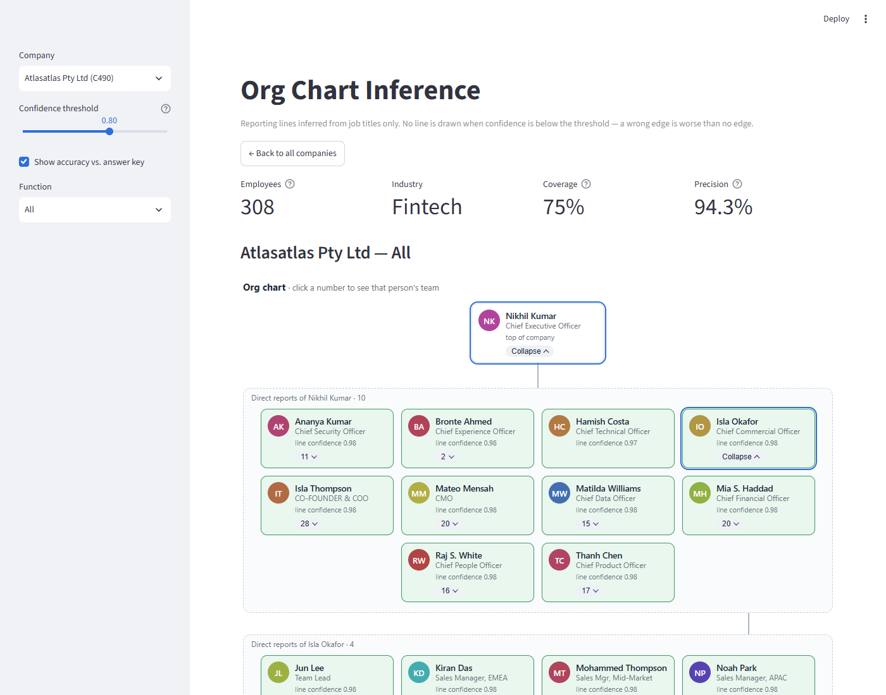
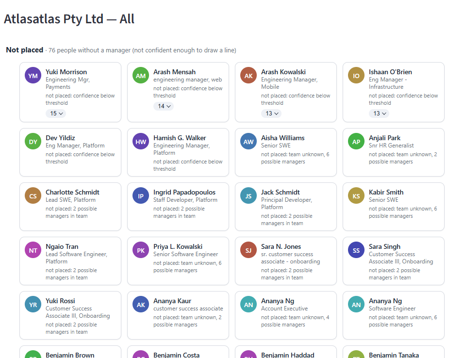
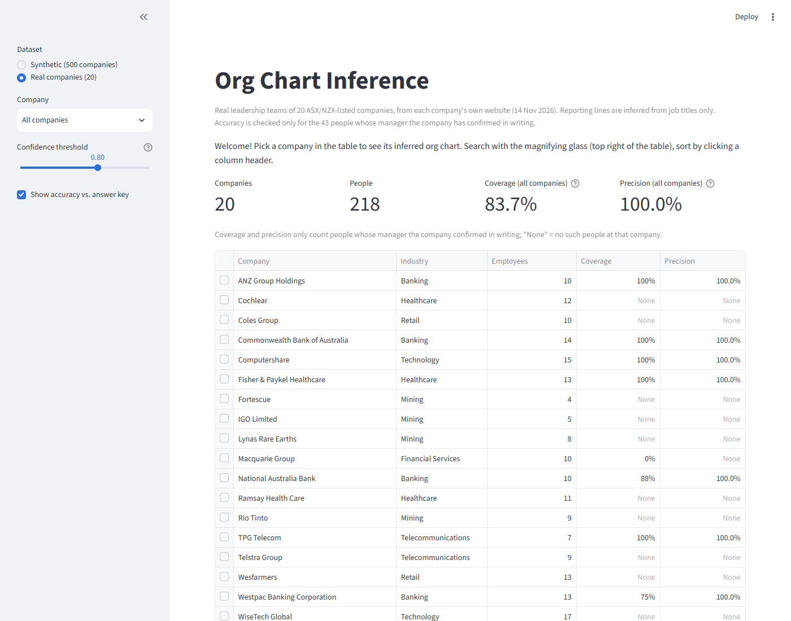
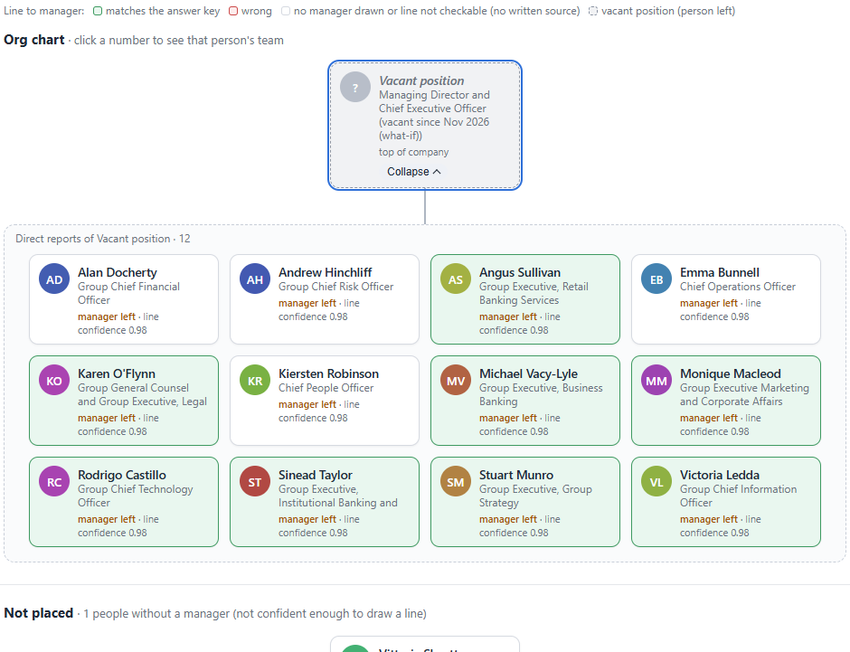

# Org Chart Inference

**Live app:** https://divya-org-chart.streamlit.app
*(Free hosting sleeps when idle. If you see "Yes, get this app back up!", click it and allow
2-3 minutes while the dataset is rebuilt.)*

Turns a flat list of employees (name + job title + messy extras) into an org chart, with a
confidence on every reporting line. When the evidence isn't strong enough, the manager is
left blank with a reason, because a wrong edge is worse than no edge.

## Results

Measured against a hidden answer key, on 500 companies (~158k people) of realistic,
messy data:

| Dataset | Precision | Coverage | Wrong lines |
|---|---|---|---|
| App data (seed 42) | **96.3%** | 58.7% | 3,465 of 92,408 |
| Held-out data (seed 7, never looked at while building) | **96.3%** | 60.6% | 3,399 of 91,050 |

- **Precision**: of the reporting lines drawn, the share that are correct.
- **Coverage**: the share of people (excluding CEOs) who got a manager.
- Confidence is **calibrated**: lines scored ~0.8 are right ~80% of the time, ~0.98 about 97%.
- Full history of every change and its numbers: [docs/experiments.md](docs/experiments.md).

## Real data

To check the rules outside my own generator, I also tested them on real companies:

- **20 ASX/NZX-listed companies** from 6 industries (banks, telecom, retail, mining, healthcare,
  tech), with **218 leaders** copied from each company's own leadership page.
  LinkedIn wasn't used.
- **43 confirmed reporting lines.** These are the only people whose manager the company states
  in writing:
  - **12 explicit**: a press release about that person, e.g. "…reporting to CEO Anthony Miller".
  - **31 team statements**: an annual report or governance statement that says a named team
    reports to the CEO.

  Everyone else is left unscored rather than guessed.

| Real data (43 confirmed lines) | Lines drawn | Correct | Coverage |
|---|---|---|---|
| Before the title fixes | 0 | – | 0% |
| After the title fixes | **36** | **36 of 36** | **84%** |

- **Why it started at zero:** real executive titles look different from the synthetic ones.
  "Managing Director and Chief Executive Officer" was read as a Director, and "Group
  Executive, Retail Banking" couldn't be read at all, so no CEO was found.
- **Five small title fixes** solved most of it: CEO titles, a leading "Group ", "Chief …
  Officer", "Group Executive / General Counsel / Company Secretary", and divisional CEOs such
  as "Chief Executive Officer, Westpac New Zealand".
- **The synthetic results above are unchanged** (seed 42 and seed 7: same precision,
  coverage, wrong lines and Brier score).
- **Limits:**
  - The sample is small: one wrong line would cost about 3 points of precision.
  - Public sources only cover the **top layer** (the CEO and their direct reports), so this
    doesn't test the deeper levels.
  - 7 titles are still misread.

Full tables and the list of misread titles: [docs/real_data_results.md](docs/real_data_results.md).

## The app

- **Front page:** overall precision and coverage, plus a table of all 500 companies (name,
  industry, employees, coverage, precision). You can search it, sort it by any column, and
  click a row to open that company. The sidebar dropdown stays in sync.
- **Shareable links:** each company has its own address, e.g.
  [?company=C490](https://divya-org-chart.streamlit.app/?company=C490).
- **Expandable org chart:** starts with the CEO. Each card shows name, title and the
  confidence of the line to their manager, plus a count of everyone under that person.
  Click the count to open their direct reports, and "Collapse" to close them.
- **"Not placed" section:** people the model didn't give a manager are listed with the
  reason, so nobody is lost. Teams under them can still be expanded.
- **Accuracy view:** with "Show accuracy" ticked, cards are green (matches the answer key)
  or red (wrong). The confidence slider shows what changes at other thresholds.
- **Tooltips:** the "?" next to Employees, Coverage, Precision and the threshold explain
  each number.
- Also: a "Who does this person report to?" chain and a function filter.

Screenshots, in case the app is asleep:

**Front page:** overall results and the searchable, sortable company table


**Expanded org chart** (Atlasatlas Pty Ltd, C490): CEO, their direct reports, and one team opened


**Not placed:** people without a confident manager, each with the reason


## What if

**Dataset switch:** the sidebar has a **Dataset** choice:
- **"Synthetic (500 companies)"**, the generated data with the full answer key.
- **"Real companies (20)"**, the public leadership teams. Here, accuracy is only checked for
  the 43 people with a confirmed manager. Other drawn lines stay uncoloured, because there's
  nothing to check them against.

Links remember the choice, e.g. `?data=real&company=R01` opens Commonwealth Bank.

**Dataset switch:** the real companies, with coverage and precision on the confirmed lines
("None" = no confirmed lines at that company)


**"What if…" section:** each company page has this section above the chart. It lets you change
the company and see how the model reacts:

- **Someone leaves:** pick a person, and optionally the company they join. Click **Simulate
  leaving**.
  - Their role stays on the chart as a grey, dashed **vacant card**, e.g. "Chief Security
    Officer (vacant since Nov 2026)", so the gap is visible instead of hidden.
  - The people who reported to them now report to the vacant card and are labelled
    **manager left**.
  - If they join a company in the data, they appear there too.
- **Add people:** enter a name, title and (optionally) a department, then click **Add**. The page
  shows where the new person lands, with the line's confidence, or the reason no manager was
  drawn.
- **Reset** clears all changes.

The model is re-run in memory for the affected companies only. Changes are **per visitor**
(your browser session) and **never saved**, so they don't change the results above or anyone
else's view.

**"What if" example:** the CEO leaves Commonwealth Bank. *This is a simulation in the app, not
real news.* The CEO role becomes a vacant card at the top, and the executives under it are
marked "manager left".


## How I know it works

Designing the data so it could be scored was the first decision:

1. **Truth first.** `generate_data.py` builds each company top-down (CEO -> C-level -> VP ->
   Director -> Manager -> ICs), so every person's real manager is known. It then writes a
   messy copy without the manager column. Inference only sees the messy copy.
2. **Hard cases are labelled.** Every person carries a scenario tag (normal, unusual title,
   two managers in one team, manager missing from the data, contractor, dotted line), so
   results can be split by what makes them hard instead of hiding behind one average.
3. **Three datasets, three jobs.** Seed 1 trains the confidence model, seed 42 is for
   development and the app, and seed 7 is held out. Training is split **by company**, never
   by row, to avoid leakage.
4. **I tested my own circularity.** I wrote the first rules on simpler data (99.1% precision),
   then built harder, realistic data. The same rules dropped to **84.0%**. That gap is the
   honest measure of "rules tuned to their own generator", and it drove the next round of work.
5. **Wrong lines are not all equal.** `evaluate.py` separates skip-level errors (the boss's
   boss: right chain, too high) from dotted-line and other errors, and reports calibration,
   Brier score, and precision/coverage by level and by scenario.

## The data

`python generate_data.py`: 500 companies, 100-1,200 employees each (55% small, 30% mid,
15% large), 8 industries, 6 locations, 10 functions with teams, 8 seniority levels.

Realism (hard cases, each tagged in the answer key):
- Real-world titles: "Founder & CEO", "Managing Director", "CHRO", "SVP", "Head of
  Engineering" (a VP), "Team Lead", "Staff/Principal", "Graduate", "Intern".
- IC titles containing "manager": "Customer Success Manager", "Account Manager".
- Teams with two managers, 6% of middle managers missing from the data, 5% contractors,
  and data analysts embedded in business teams (solid line to Data, dotted line to the business).

Mess: synonyms, abbreviations (Sr., Mgr, Dir., SWE, CTO), random casing, dropped team names,
inconsistent separators, extra spaces, 25% blank departments, 2% blank titles, 5% blank
locations, 1% duplicate rows. `--v1` rebuilds the original simpler dataset; `--seed N` builds
a new held-out set.

## Approach

1. **Read each title** (`infer.py`): clean and expand abbreviations, strip founder and
   contractor wording, then read level by keyword priority (VP > Director > Junior > Manager >
   Senior; "Lead" depends on position), function from keywords or department, and team from
   the text after the comma.
2. **Use the rest of the company.** A team name tells you the function, which fills blank
   departments. 3+ "managers" in one team means it's really an IC title there.
3. **Find the manager** by walking up the layers in the same function (Manager -> Director ->
   VP -> C-level), matching team at team levels.
4. **Abstain with a reason** when it's ambiguous: several candidates, candidates without a
   team, an IC whose team manager is missing, a team that belongs to another function
   (dotted line?), a teamless "Head of" that might be the VP, or an unreadable title.
5. **Score confidence with a decision tree** (`train_confidence.py`). It's trained on a separate
   dataset, using 13 pieces of evidence behind each line (layers skipped, team present,
   candidate pool, teamless managers nearby ...). It has 9 leaves, and you can read them in
   [models/confidence_tree.txt](models/confidence_tree.txt). It's saved as JSON, so the app
   doesn't need scikit-learn.
6. **Draw only above 0.8.**

## Key decisions

- **Precision over coverage.** A sales rep emailing the wrong "boss" is worse than seeing
  "unknown".
- **The threshold is derived, not tuned.** If a wrong line costs 4x a missing one, a line is
  worth drawing when P(correct) > 4/5 = 0.8. A different business cost changes one number.
- **A small readable tree over a black box.** A depth-8 tree scored slightly better (Brier
  0.0440 vs 0.0465) but has 57 leaves. Nine leaves can be checked by a person. One of them
  shows that a line skipping a layer other teams have is 0% correct (965 edges), which the
  hand-set penalties had scored 0.70.
- **Every change is checked on all datasets.** E.g. stripping "Group " for "Group CEO"
  silently turned "Group Product Manager" into an IC. The regression check on the original
  data caught it.

## Limitations

- **Two-manager teams** (63% precision on the lines still drawn) and **missing managers**
  remain hard. Usually one manager's title lost its team name, so only one candidate is visible.
- **Synthetic data.** Held-out seeds share the generator's recipe. On real data I'd
  hand-label a stratified sample of companies as the test set and add a "this is wrong"
  feedback loop that feeds the tree.
- **Dotted lines** are detected (and abstained on), not drawn. A real product should store
  solid and dotted edges as two types.
- **Next experiment:** GLiNER / GLiNER2 (small zero-shot extraction models) run offline on
  the ~5,400 unique titles, to read title formats the rules were never written for. See
  [docs/research_models.md](docs/research_models.md).

## How to run

Windows, Python 3.13. Library versions are pinned in `requirements.txt` (the exact versions
the app was tested with), so the hosted app doesn't change when new releases come out.

```
python -m venv .venv
.venv\Scripts\activate
pip install -r requirements.txt

python generate_data.py        # data/truth.csv (answer key) + data/employees.csv (messy)
python infer.py                # data/predictions.csv
python evaluate.py             # precision, coverage, calibration, by level / scenario
streamlit run app.py           # the app (builds the data itself if missing)

python train_confidence.py     # retrain the confidence tree (seed 1)
python generate_data.py --seed 7 --out data/holdout_seed7    # held-out check
python infer.py data/holdout_seed7
python evaluate.py data/holdout_seed7

python scripts/build_real.py         # data/real/employees.csv (218 public leaders) + sources.csv
python scripts/build_real_truth.py   # data/real/truth.csv (the 43 confirmed lines + quotes)
python infer.py data/real
python evaluate.py data/real         # scores only the confirmed lines, by evidence type

python scripts/add_people.py R10 scripts/new_people_example.csv          # try: temporary copy
python scripts/add_people.py R10 scripts/new_people_example.csv --save   # keep for good
```

Changes that go into the data files (the app's "What if" section never writes files):

- **`scripts/add_people.py`** adds people from a small CSV (`full_name, title, department`) to
  one company and prints who the model says they report to.
  - Without `--save`, it works on a copy in `data/real_added/`.
  - With `--save`, it adds them to `scripts/added_people.csv` and rebuilds the real data.
- **`scripts/added_people.csv`** lists people added by hand. They're added to the real data
  as `source = "manually added"` and are **never scored**.
- **`scripts/leavers.csv`** (`company_id, full_name, left_date, new_company`, optional `note`)
  lists people who left. When the data is built, each leaver's role becomes a vacant card.
  Their reports are marked "manager left", and the person is added to their new company if
  it's in the data.

Both CSV files are kept **empty** in this repo, so the results above stay exactly as reported.

| File | What it does |
|---|---|
| `generate_data.py` | true org chart + messy copy |
| `infer.py` | title parsing, manager search, abstentions, tree confidence |
| `train_confidence.py` | trains the confidence tree on a separate dataset |
| `evaluate.py` | scores predictions against the answer key |
| `app.py` | Streamlit app: dataset switch, company table, company page, "What if" |
| `org_chart.py` | the expandable org chart (plain HTML/CSS/JavaScript) |
| `whatif.py` | the app's "What if" changes, re-run in memory |
| `leavers.py` | turns leavers into vacant cards (used by both data builders and "What if") |
| `scripts/build_real.py`, `scripts/build_real_truth.py` | real leadership data and its confirmed lines |
| `scripts/add_people.py` | add people to a real company (temporary, or `--save`) |
| `scripts/added_people.csv`, `scripts/leavers.csv` | hand-added people and leavers (empty) |
| `docs/real_data_results.md` | real-data results, before/after the title fixes |
| `models/` | the trained tree (JSON + readable rules) |
| `docs/experiments.md` | every experiment and its numbers |
| `docs/research_models.md` | notes on decision models and GLiNER |
| `CLAUDE.md`, `.claude/` | project context and an `/eval` command for Claude Code |

## How I used AI
- I used Claude Code, an AI coding assistant, inside VS Code for this project.
- The AI wrote most of the code: the data generator, the inference rules, the evaluation and the app.
- I read the task brief, set the goal, and asked the AI to explain every step in simple words so I understood what the code does.
- I checked the results myself: I tested the live app, looked at people the model left without a manager, and checked that the reasons made sense.
- I made the key choices, like preferring precision over coverage, testing on a separate held-out dataset, and adding the decision tree for confidence.
- Before each upload, I checked git status so that private files, like the task brief, were never made public.
- I can explain every file, and I have kept the AI’s notes in docs/experiments.md so reviewers can see what was tried.
