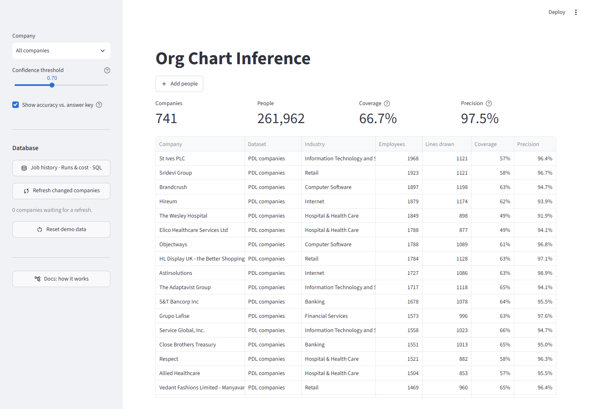

# Org Chart Inference

Turns a flat list of people and job titles into an org chart, with a confidence on every
reporting line. It leaves the manager blank, with a reason, when it isn't sure. Everything
lives in a Postgres database, and every change keeps its history.

**Live app:** https://divya-org-chart.streamlit.app
*(Free hosting sleeps when idle. If you see "Yes, get this app back up!", click it and wait
a minute.)*



## What it does

- **Infers who reports to whom** for every company, from names, job titles and (if given) a
  department. It never sees the real reporting lines.
- **Gives every line a confidence** and draws it only at 0.7 or above, because a wrong line
  is worse than no line. Everyone without a line is listed with the reason.
- **Measures itself** against an answer key on 740 real companies filled with synthetic
  people, and offline on earlier datasets that include real published reporting lines.
- **Keeps a history:** people can be added, removed, promoted or moved to another company
  in the app. Each change is saved with its history, and only the companies that changed
  are worked out again.
- **Lets you query the data:** job history, runs and their cost, and read-only SQL, all in
  the app.

## How it works


1. **Title parsing.** Each title is cleaned ("Sr. Mgr" → "senior manager") and read into a
   **level** (1 = CEO … 8 = intern), a **function** (Engineering, Sales …) and a **team**.
2. **Company context.** The rest of the company fixes single titles:
   - it finds the CEO;
   - a team or unit name fills in a missing function;
   - 3+ "managers" in one team are really individual contributors;
   - a divisional CEO sits below the group CEO.
3. **Manager search.** It looks one level up in the same function (and team), then climbs.
   If nobody fits, or several people do, it **abstains** and saves the reason.
4. **Confidence tree + threshold 0.7.** A small decision tree (9 readable leaves, trained on a
   separate dataset) scores each proposed line. A line is drawn only at **confidence ≥ 0.7**:
   a wrong line costs about **2.3×** a missing one, so a line is worth drawing when it is
   right at least 70% of the time (2.3 / 3.3 ≈ 0.7).

The rules are in `infer.py`. `refresh.py` runs them on the database.

## Database

A free **Supabase Postgres** database. The app reads and writes **only** the database.

| Table | One row is … | Rows |
|---|---|---:|
| `companies` | a company; `needs_refresh` = its chart is out of date | 985 |
| `people` | a person (once, even after moving between companies) | 262,060 |
| `employments` | one job: person, company, title, start and end date, `is_current`, `change_type` | 340,222 |
| `reporting_lines` | a person's inferred manager in one refresh: confidence, reason, judge | 262,012 |
| `answer_key` | a person's true manager, only for measuring; the model never reads it | 262,007 |
| `runs` | one load, refresh or PDL call: time, companies and people, credits, tokens, cost | 29 |
| `sources` | kept for source links; empty now | 0 |
| `change_log` | one change made in the app: which job rows it opened and closed (for undo) | 0 |
| `saved_queries` | queries saved from the app's SQL tab | 0 |

The 985 companies are the 740 PDL companies, Atlassian, and Atlassian people's 244 past
employers (hidden in the app).

- **History is never overwritten.** A title change or a move **closes** the old job (end
  date, `is_current = false`) and **opens** a new one, linked to the old one. Undo reopens
  the old row.
- **Size:** 273.6 MB of the free 500 MB. The highest size measured during repeated full
  refreshes was **338.8 MB**, under this project's 450 MB limit.
- **Details:** `db/schema.sql` and `db/migrations/`; [db/README.md](db/README.md) explains
  every table.

## Data sources

| Source | Companies | People | Answer key |
|---|---:|---:|---|
| **PDL company dataset** (real companies, synthetic people) | 740 | 262,007 | 261,267 people with a known manager |
| **People Data Labs person API** (real people at Atlassian) | 1 current + 244 past employers | 53 | none |

The app's front page shows 261,962 people: 98 generated rows are exact duplicates of a
colleague's name, title, department and location, and the rules count them once.

### PDL companies with synthetic people

**The companies are real. The people, job titles, reporting lines and job histories at these
740 companies are synthetic.** They do not describe the real staff or structure of these
companies. The real company fields used are name, domain, industry, size, founding year,
city and country.

Company data: People Data Labs, [CC BY 4.0](https://creativecommons.org/licenses/by/4.0/).
Source: [PDL free company dataset](https://docs.peopledatalabs.com/docs/free-company-dataset).
Changes made: filtered to the mix below, duplicates removed, and name capitals tidied.

| Country | 51-200 | 201-500 | 501-1000 | 1001-5000 | Companies | People |
|---|---:|---:|---:|---:|---:|---:|
| Australia | 94 | 56 | 22 | 14 | 186 | 64,591 |
| India | 97 | 53 | 24 | 15 | 189 | 65,985 |
| United Kingdom | 92 | 53 | 22 | 14 | 181 | 65,263 |
| United States | 94 | 53 | 22 | 15 | 184 | 66,168 |
| **Total** | **377** | **215** | **90** | **58** | **740** | **262,007** |

- **Selection:** companies with a domain, founding year and city, across software, financial
  services, healthcare, retail / e-commerce and IT consulting. Public bodies are excluded.
- **Size:** every company has at least 100 people (largest: 1,969).
- **People:** made by `generate_pdl_people.py`, across 10 departments and every level from CEO
  to intern.
- **Messy titles:** about 12.5% have abbreviations, typos, mixed case, extra words or vague
  wording, or are blank.
- **Past jobs:** 77,702 people (about 30%) have one: 42,603 job changes and 35,099 title
  changes.
- **Hard cases:** teams with two managers, managers missing from the data, contractors, and
  analysts with a dotted line to a business team.

### People Data Labs person API (Atlassian)

PDL's free person search API returned 50 senior people (C-level, VP, director) at Atlassian.
A second search added its CEO, Chief Revenue Officer and Chief People and AI Enablement
Officer: 53 people, each with their job history.

- **History:** 513 jobs: 284 company changes and 176 title changes.
- **Credits:** 55 of the free plan's ~100 a month (2 for the test call, 50 for the first
  search, 3 for the leaders).
- **Stored:** only the needed fields (name, title, company, dates, department, seniority). No
  emails, phone numbers, social links or addresses, in the database or in the local cache.
- **Cached:** responses are cached in `data/pdl/cache/` (not in git), so a rerun never spends
  credits.
- **Terms:** the person data is used under PDL's terms.
- **Privacy:** they are real people, so the app shows only their name and current job. Their
  past jobs stay in the database and are hidden from the Job history tab and the SQL tab.

## Changes and refresh

- **Add, remove, promote / change title and change job** are saved in the database with
  history (`db/changes.py`). "New organisation" creates a company with source `manual`.
- **Every change marks the affected companies** `needs_refresh`. A move marks both the old
  and the new company.
- **"Refresh changed companies"** (sidebar) re-infers **only** those companies and saves
  their new lines. Everything else stays as it is.
- **Undo last change** reverses the newest saved change and marks its companies for refresh.
- **Reset demo data** (sidebar, with a confirm step) removes everything created in the app
  (jobs, people, organisations, saved queries, change log), puts people back in their
  loaded jobs and refreshes the affected companies.
- **Add people** takes at most 20 people at a time.
- **Before vs Now** (Reports tab) compares a company's previous refresh with the latest one.
- **Cleanup:** for each company, only the lines of its **last 2 refreshes** are kept.
  Employment history is never deleted.

| Org chart (N001) | Runs & cost |
|---|---|
|  |  |

## Cost and logging

- **`runs` table:** every load, refresh and PDL call is a row with start and end time,
  companies and people processed, lines written, PDL credits, Gemini calls and tokens, and
  cost in USD. The app's **Runs & cost** tab shows the totals and every run.
- **Prices** are kept in one place, `db/costs.py`, with their source link:
  - the rules cost $0;
  - Gemini is costed at its list price per token;
  - PDL credits are $0 on the free plan.
- **Total so far:** $0. 55 PDL credits used, 0 Gemini tokens.
- **Logfire:** each refresh sends one span per run and one per company: people processed,
  lines drawn, not placed, time, judge and cost. **Only IDs and counts are sent, never
  names or titles.** Without a `LOGFIRE_TOKEN` everything still works, without logging.

## Query the data

Sidebar → **Database**:

- **Job history:** pick a person and see every job in order: company, title, dates, and
  whether it was a title change or a job change. For PDL people, only the current job.
- **Runs & cost:** the totals, then every run.
- **SQL:** one `SELECT` or `WITH` statement. It runs as a **read-only database role**, inside
  a **read-only transaction**, is stopped after **5 seconds**, and gets **LIMIT 500** if it
  has none. A dropdown has 8 example queries, plus queries saved with **Save query**.


Three examples:

```sql
-- One person's job history
select c.name as company, e.title, e.start_date, e.end_date, e.change_type
from employments e join companies c using (company_id)
where e.person_id = 'N001-E0002'
order by e.start_date nulls first, e.employment_id;

-- A company's current org chart
select p.full_name, m.full_name as manager, rl.confidence, rl.reason
from reporting_lines rl
join people p      on p.person_id = rl.person_id
left join people m on m.person_id = rl.manager_id
where rl.company_id = 'N001' and rl.is_current;

-- Precision and coverage per dataset
select c.source, count(*) as people_scored, count(rl.manager_id) as lines_drawn,
       round(100.0 * count(*) filter (where rl.manager_id = a.true_manager_id)
             / nullif(count(rl.manager_id), 0), 1) as precision_pct,
       round(100.0 * count(rl.manager_id) / count(*), 1) as coverage_pct
from answer_key a
join companies c using (company_id)
left join reporting_lines rl on rl.person_id = a.person_id
                            and rl.company_id = a.company_id and rl.is_current
where a.true_manager_id is not null
group by c.source;
```

## Safety and privacy

- **Open to everyone:** anyone can add, remove, promote, refresh, undo or save a query.
  Changes are shared, and **Reset demo data** puts the loaded data back.
- **PDL people (real people):** the app shows their name and current job only. Their past
  jobs and past employers are hidden in the app and, by a database rule, in the SQL tab.
- **No paid calls from visitors:** changes made in the app are placed by the rules. The app
  never calls Gemini or PDL.
- **Visitor text is shown as plain text:** names and titles can't add links or images.
- **SQL tab:** a read-only role that can only read this project's tables. It can't see
  Supabase's own schemas (such as `auth` or `vault`), and queries that try to switch roles
  are refused.
- **Supabase's public web API is blocked:** row level security is on for every table.
- **Secrets** live only in `.streamlit/secrets.toml` (git-ignored) locally and in Streamlit
  Cloud → Settings → Secrets when deployed. They are never in git, never printed and never
  logged.

## Results

### In the app

Threshold 0.7, from the database (current reporting lines vs. `answer_key`).
**Precision** = of the lines drawn, the share that are right. **Coverage** = the share of
people with a known manager who got a line.

**740 PDL companies: 97.5% precision, 66.7% coverage.** 261,267 people were scored, 174,336
lines were drawn, and 4,395 of them are wrong. The database and CSV results are identical.

| Case | People | Precision | Coverage |
|---|---:|---:|---:|
| Normal | 208,296 | 99.5% | 77.1% |
| Contractors | 8,619 | 99.7% | 86.8% |
| Teams with two managers | 28,031 | 68.6% | 14.3% |
| True manager missing from the data | 14,941 | 0% | 14.9% |
| Dotted-line analysts | 1,380 | 0% | 0.5% |

These people are synthetic, and this dataset is less messy than the earlier generated one, so
**97.5% should not be read as an improvement over the 95.2% below**. The rules did not change.

**Atlassian:** no answer key, so its lines can't be scored. The rules draw **7 lines** for the
53 people and abstain for the rest rather than guess, because only senior people were fetched.

### Offline evidence (files only, not in the app)

These datasets are no longer in the database or the app. They remain in the repo's offline
pipeline, including checks on real published reporting lines.

| Dataset | Precision | Coverage |
|---|---|---|
| Earlier generated data, seed 42 (CSV baseline) | 95.2% | 62.7% |
| Earlier generated data, seed 7 (**held out**) | 95.4% | 63.7% |
| Real ASX/NZX leadership (43 confirmed lines) | 100% (36 of 36) | 83.7% |
| Real UK government organograms, all 12 | 84.5% | 18.8% |
| UK, tune half (UK fixes designed here) | 83.6% | 12.6% |
| UK, **test half** (never looked at) | 85.0% | 25.3% |

Details: [docs/experiments.md](docs/experiments.md), [docs/uk_results.md](docs/uk_results.md)
and [docs/real_data_results.md](docs/real_data_results.md). The UK results contain public
sector information licensed under the
[Open Government Licence v3.0](https://www.nationalarchives.gov.uk/doc/open-government-licence/version/3/).

### Rules vs Gemini judge

As an option, Gemini can place a person instead of the rules. It gets the person's name,
title and unit, plus at most 8 candidate managers chosen by the rules: never the whole
company, never the answer key. The public app uses the rules only, so visitors can't spend
Gemini credits. The comparison was run once, offline, on small samples of the earlier
datasets ([docs/judge_comparison.md](docs/judge_comparison.md)). Gemini had lower precision
on every dataset, so the rules stay the default: they are also free, instant and repeatable,
and they give a reason for each line.

### Limits

- **The main dataset is generated by our own code.** The real company names don't make the
  people or reporting lines real, which is why the offline real-data checks matter.
- **Small answer keys for real data:** ASX/NZX has only 43 confirmed lines, all from the top
  layer. UK files stop at Deputy Director level.
- **Atlassian:** 53 senior people, no answer key. The free plan's ~100 credits a month can't
  fill companies of 100+ people.
- **Still hard:** teams with two managers, managers missing from the data, and dotted lines
  (detected, but never drawn).
- **SQL time limit:** the two largest example queries usually take 1 to 3 seconds, but a first
  run on a cold database has taken up to 5 seconds, so it can occasionally hit the limit.
- **Free tiers:**
  - Supabase pauses a project after about a week with no activity; the app then says
    "Database not connected" until it is resumed.
  - Gemini's free tier allows only a few requests a day.

## Run it locally

Windows, Python 3.13; versions are pinned in `requirements.txt`.

```
python -m venv .venv
.venv\Scripts\activate
pip install -r requirements.txt
```

**1. Secrets.** In `.streamlit/secrets.toml` (git-ignored), names only:

| Name | Needed for |
|---|---|
| `DATABASE_URL` | the database (Supabase session pooler address, with `[YOUR-PASSWORD]` in it) |
| `DATABASE_PASSWORD` | the database |
| `LOGFIRE_TOKEN` | optional: logging |
| `GEMINI_API_KEY` | optional: the Gemini judge |
| `PDL_API_KEY` | only for `scripts/pdl_load.py` when its cache is missing |

**2. Database tables**, in this order:

```
python scripts/run_sql.py db/schema.sql
python scripts/run_sql.py db/migrations/001_pdl_history.sql
python scripts/run_sql.py db/migrations/002_manual_changes.sql
python scripts/run_sql.py db/migrations/003_costs.sql
python scripts/run_sql.py db/migrations/004_trigger_once.sql
python scripts/run_sql.py db/migrations/005_app_reads.sql
python scripts/run_sql.py db/migrations/006_app_changes.sql
python scripts/run_sql.py db/migrations/007_company_run_index.sql
python scripts/run_sql.py db/migrations/008_public_app.sql
python scripts/run_sql.py db/migrations/009_short_pdl_ids.sql
python scripts/run_sql.py db/migrations/010_pdl_companies.sql
python scripts/run_sql.py db/migrations/011_remove_old_sources.sql
python scripts/run_sql.py db/migrations/012_remove_uk_source.sql
python scripts/check_db.py              # version, tables and row counts
```

`db/schema.sql` creates the tables, so run it only once, on an empty database. The
migrations are safe to run again.

**3. Source data.** Download PDL's
[free company dataset](https://docs.peopledatalabs.com/docs/free-company-dataset) to
`data/pdl/free_company_dataset.csv.zip` (git-ignored; no API call), then:

```
python scripts/pdl_shortlist.py pool                # usable companies, read from the download
python scripts/pdl_shortlist.py extend --people 265000   # picks companies with the same mix
python scripts/load_pdl_companies.py                # companies + generated people + past jobs
python scripts/pdl_load.py              # PDL people from data/pdl/cache/ (calls PDL only if the cache is missing: spends credits)
python scripts/pdl_load_leaders.py      # Atlassian's 3 leaders from the cache (calls PDL only if the cache is missing: spends credits)
python scripts/pdl_record_runs.py       # the PDL calls as runs rows (credits)
```

The shortlist file is git-ignored, so a fresh run picks a list with the same mix, but not
exactly the same 740 companies.

**4. Infer, then start the app:**

```
python refresh.py                       # infers every company that needs it, logs a run
streamlit run app.py
```

**Tests:**
- `python scripts/test_app.py` (read only)
- `python scripts/test_app_changes.py` (adds, refreshes, undoes and resets changes, then puts
  the database back exactly as it was)
- `python scripts/check_pdl_load.py` (read-only checks of the generated people and history)
- `python infer.py data/pdl_synth`, then `python evaluate.py data/pdl_synth` and
  `python scripts/compare_db_csv.py` (database vs CSV results)

**Maintenance:**
- `python scripts/backup_db.py` exports every table to `data/backup/` (git-ignored).
- `python scripts/compact_db.py` runs a normal `VACUUM`. With `--full`, it also rebuilds only
  the tables that fit safely under 450 MB.
- `python scripts/refresh_watch.py` runs a refresh and stops it if the database passes 450 MB.

The offline pipeline (`generate_data.py`, `infer.py`, `evaluate.py`, held-out seed 7, real
datasets) still runs on files for measuring.

**Project structure (main files):**

| File | What it does |
|---|---|
| `app.py` | the Streamlit app (reads and writes only the database) |
| `infer.py` | title parsing, company context, manager search, confidence |
| `refresh.py` | re-infers companies that changed, logs runs and cost, Logfire |
| `db/` | schema, migrations, connection, reads, changes, costs, logging |
| `org_chart.py` | the expandable org chart (HTML/CSS/JavaScript) |
| `judge_gemini.py` | the optional Gemini judge |
| `generate_pdl_people.py` | synthetic people, titles, managers and past jobs for the real companies |
| `generate_data.py`, `evaluate.py`, `train_confidence.py` | offline generated data, scoring, confidence tree |
| `scripts/` | selecting and loading companies, PDL, backup, maintenance, tests |
| `docs/` | plan, experiments, results, flow diagram, screenshots |

## How I used AI

- I used Claude Code, an AI coding assistant, inside VS Code for this project.
- **Claude Code wrote most of the code:** the data generator, the inference rules, the
  evaluation, the database, the refresh and the app.
- **I set the goals and made the key choices:**
  - preferring precision over coverage;
  - testing on held-out data;
  - adding the decision tree for confidence;
  - moving everything into a database with history;
  - keeping PDL credits to a small, cached batch;
  - showing real people's current job only.
- I worked step by step: a small plan first, small data first, and the AI explained each
  change in simple words before I moved on.
- **I tested every feature myself in the app** (adding, removing, promoting, refresh, undo,
  SQL), and checked the numbers against the answer key and the earlier results.
- Before each upload I checked `git status`, so secrets and private files were never
  published.
- Every change and its numbers are logged in [docs/experiments.md](docs/experiments.md).

## Sources

- **Company data:** People Data Labs, [CC BY 4.0](https://creativecommons.org/licenses/by/4.0/),
  from the [free company dataset](https://docs.peopledatalabs.com/docs/free-company-dataset).
  Filtered, de-duplicated, and name capitals tidied.
- **People at those companies:** synthetic, generated by `generate_pdl_people.py`.
- **Atlassian people:** the People Data Labs person search API (free plan), November 2026.
- **Offline UK evidence:** the newest senior-staff organogram CSV of 12 organisations from
  [data.gov.uk](https://www.data.gov.uk/), downloaded 16 Nov 2026 (pinned URLs in
  `scripts/download_uk.py`). Open Government Licence v3.0.
- **Offline ASX/NZX evidence:** each company's own leadership page and written statements,
  checked 14 Nov 2026. Links and quotes are in `scripts/build_real.py` and
  `scripts/build_real_truth.py`.
