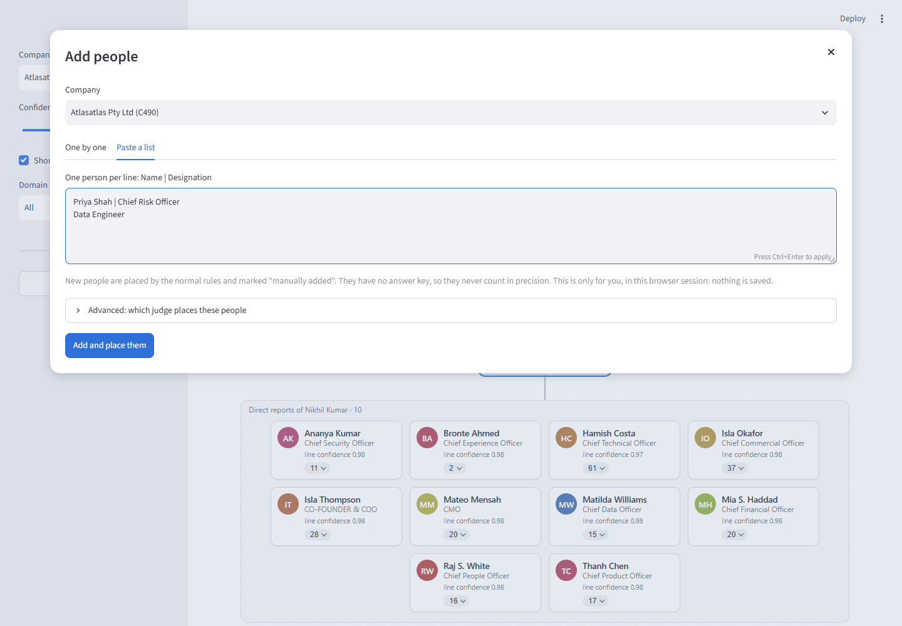
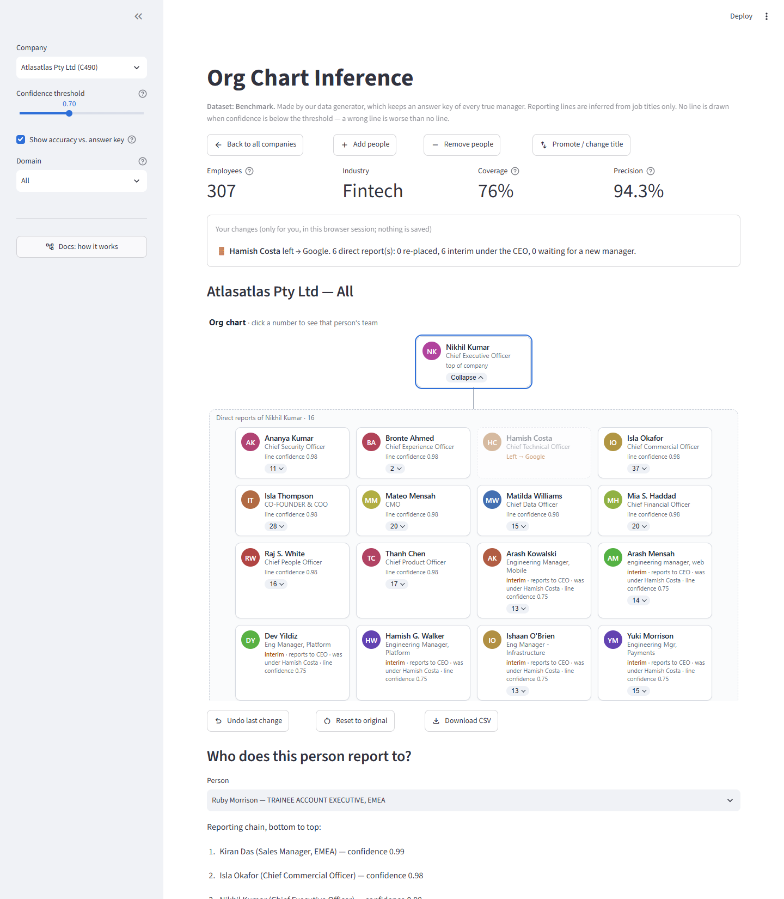
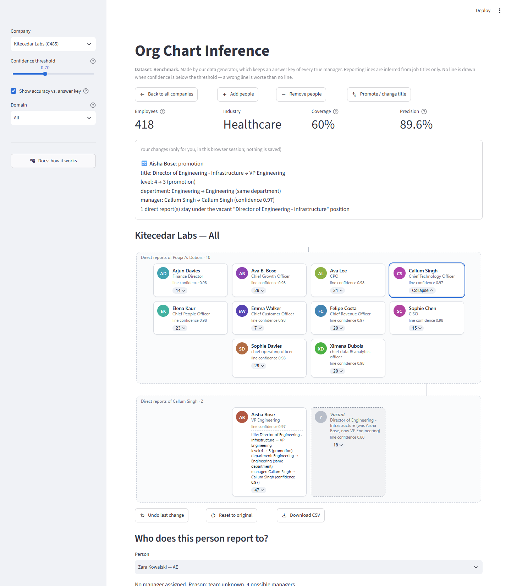
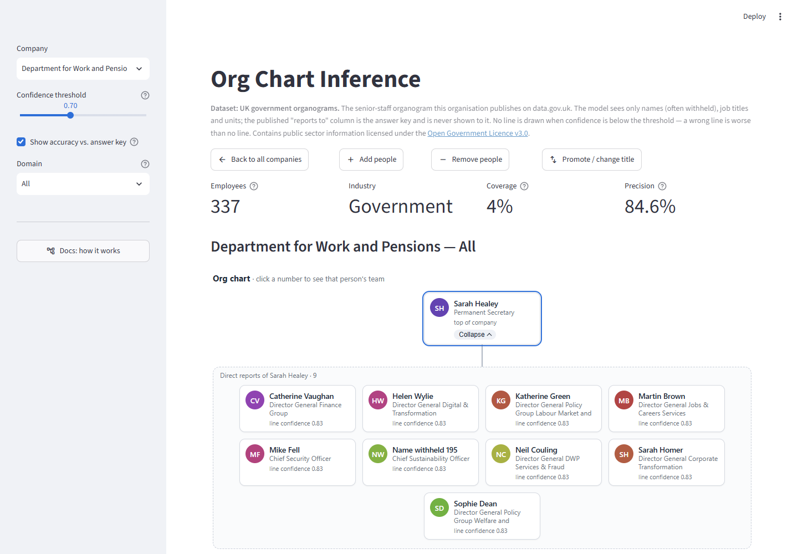
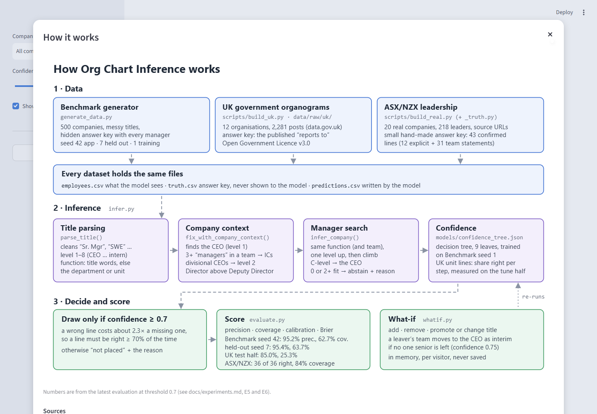

# Org Chart Inference

Turns a flat list of people and job titles into an org chart, with a confidence on every
reporting line, and leaves the manager blank (with a reason) when it isn't sure.

**Live app:** https://divya-org-chart.streamlit.app
*(Free hosting sleeps when idle. If you see "Yes, get this app back up!", click it and allow
2–3 minutes while the data is rebuilt.)*


## What it does

- **Infers who reports to whom** for every organisation, from names, job titles and (if
  given) a department or unit. It never sees the real reporting lines.
- **Gives every line a confidence** and draws it only at 0.7 or above, because a wrong line
  is worse than no line. Everyone without a line is listed with the reason.
- **Measures itself** against an answer key on three datasets: 500 generated companies, 20
  real ASX/NZX leadership teams and 12 real UK government organisations.
- **Lets you try changes** in the app: add people, remove people, and see how the chart
  reacts. An optional Gemini judge can place people instead of the rules.

## How it works


1. **Title parsing.** Each title is cleaned ("Sr. Mgr" → "senior manager") and read into a
   **level** (1 = CEO … 8 = intern), a **function** (Engineering, Sales …) and a **team**.
   UK civil-service titles have their own ladder: Permanent Secretary > Director General >
   Director > Deputy Director.
2. **Company context.** The rest of the company fixes single titles:
   - finds the CEO;
   - a team or unit name fills in a missing function;
   - 3+ "managers" in one team are really individual contributors;
   - a divisional CEO sits below the group CEO.
3. **Manager search.** Look one level up in the same function (and team), then climb. If
   nobody fits, or several people do, **abstain** and save the reason.
4. **Confidence tree + threshold 0.7.** A small decision tree (9 readable leaves, trained on a
   separate dataset) scores each proposed line from the evidence behind it. A line is drawn
   only at **confidence ≥ 0.7**: a wrong line costs about **2.3×** a missing one, so a line
   is worth drawing when it is right at least 70% of the time (2.3 / 3.3 ≈ 0.7).

## Datasets

| Dataset | What it is | Size | Answer key |
|---|---|---|---|
| **Benchmark** | Companies made by `generate_data.py`, with realistic messy titles (abbreviations, missing teams, two-manager teams, missing managers …) | 500 companies, ~158k people | The generator knows every true manager |
| **ASX/NZX leadership** | Real leadership teams copied from each company's own website | 20 companies, 218 leaders | Small: 43 lines that the company confirmed in writing (press releases, annual reports) |
| **UK government organograms** | The senior-staff organograms UK government bodies publish on data.gov.uk | 12 organisations, 2,281 posts | The published "Reports to Senior Post" column (never shown to the model, nor grade or salary) |

- Every source, with its link and date, is listed in [Sources](#sources) and in
  `data/real/sources.csv`. The app shows each company's sources under its chart.
- **UK data:** Contains public sector information licensed under the
  [Open Government Licence v3.0](https://www.nationalarchives.gov.uk/doc/open-government-licence/version/3/).

## Results

Threshold 0.7. **Precision** = of the lines drawn, the share that are right.
**Coverage** = the share of people (with a known manager) who got a line.

| Dataset | Precision | Coverage |
|---|---|---|
| Benchmark, seed 42 (used while building) | 95.2% | 62.7% |
| Benchmark, seed 7 (**held out**, never looked at) | 95.4% | 63.7% |
| ASX/NZX (43 confirmed lines) | 100% (36 of 36) | 84% |
| UK, tune half (UK fixes designed here) | 83.6% | 12.6% |
| UK, **test half** (never looked at) | 85.0% | 25.3% |

- **Before the UK fixes,** our rules managed only 33% precision and 0.5% coverage on the UK
  data. The fixes (civil-service ladder, unit as function, a confidence measured on the
  tune half) didn't change the Benchmark or ASX/NZX numbers. Details:
  [docs/uk_results.md](docs/uk_results.md).
- **The confidence is honest:** lines scored ~0.8 are right ~80% of the time.
- **Every change and its numbers:** [docs/experiments.md](docs/experiments.md).

## Rules vs Gemini judge

As an option, Gemini can place a person instead. It gets the person's name, title and unit,
plus a short list of candidate managers built from our rules (at most 8). Never the whole
company, never the answer key. Comparison from
[docs/judge_comparison.md](docs/judge_comparison.md) (`gemini-3.5-flash-lite`, free tier,
threshold 0.7):

| Dataset | Judge | People | Lines drawn | Right | Precision | Coverage |
|---|---|---|---|---|---|---|
| Benchmark seed 7 (held out) | Rules | 50 | 34 | 34 | 100.0% | 68.0% |
| Benchmark seed 7 (held out) | Gemini | 50 | 33 | 32 | 97.0% | 66.0% |
| UK test half | Rules | 50 | 21 | 16 | 76.2% | 42.0% |
| UK test half | Gemini | 50 | 27 | 19 | 70.4% | 54.0% |
| ASX/NZX (all with an answer) | Rules | 43 | 36 | 36 | 100.0% | 83.7% |
| ASX/NZX (all with an answer) | Gemini | 43 | 43 | 42 | 97.7% | 100.0% |

- **The ceiling:** Gemini can only pick the true manager if that person is on its short
  list, which happens for 72% of the Benchmark sample and 56% of the UK sample. Better
  candidate lists would matter more than a smarter model.
- **Why rules stay the default:**
  - Gemini had lower precision on every dataset (it draws more lines, and some are wrong).
  - The rules are free, instant, give the same answer every time, and each line comes with
    a reason.
  - Gemini needs a key and has tight free-tier limits.
  - ASX/NZX is an easy case for Gemini: the right answer is always the CEO, who is always on
    its list.
- **Using your own key:**
  - **Locally:** put `GEMINI_API_KEY = "your key"` in `.streamlit/secrets.toml`.
  - **When deployed:** add the same line in Streamlit Cloud under Settings → Secrets.
  - **Never commit the key.** `secrets.toml` is in `.gitignore`.
  - Without a key, the app falls back to the rules and says so.

## What-if

On any company page:

- **+ Add people:** type them **one by one** (Name optional, Designation) or **paste a list**
  (`Name | Designation` per line). You can also create a new organisation. They're placed by
  the rules (or Gemini), marked "manually added", and never counted in precision.
- **− Remove people:** pick who is leaving and, optionally, where they are **moving to**
  ("Google"). Their card stays, faded, saying "Left → Google", and their team is placed
  again. If nobody more senior is left in that function, the team **moves to the CEO as
  interim** (confidence 0.75, never scored).
- **Promote / change title:** give someone a new title. They stay, are placed again by the
  rules, and their card shows what changed (title, level: promotion / move / demotion,
  department, manager). With **Leave old position vacant** (on by default) a dashed vacant
  card keeps their old place and their team stays under it; otherwise their team stays with
  them if it still fits, or is re-placed as for a leaver. Blocked if the title can't be
  read, would make a second CEO, or hasn't changed. Never counted in precision.
- **Undo last change**, **Reset to original** and **Download CSV** (the chart as shown).
- **Only for you:** everything runs **in memory, per visitor**. Nothing is saved, and other
  visitors and the results above don't change.

| Add people | After removing the CTO ("Moving to: Google") | After promoting a Director to VP (old position vacant) |
|---|---|---|
|  |  |  |

| A company page (Benchmark) | A UK organisation (DWP) | The Docs popup |
|---|---|---|
|  |  |  |

The DWP screenshot shows the Permanent Secretary and Directors General placed correctly. Its
coverage (4%) is far below the UK average: DWP has only 10 units for 337 posts. So each
Deputy Director has several possible Directors in their unit, and the rules abstain (244 of
248 Deputy Directors get no line).

## Limits

- **Small answer keys for real data:** ASX/NZX has only 43 confirmed lines, all from the top
  layer. One wrong line would cost about 3 points of precision.
- **UK files stop at Deputy Director level,** so only the top 4–5 levels are tested, in 12
  organisations.
- **The Benchmark is generated by my own code.** The held-out seed shares its recipe, which is
  why the real datasets matter.
- **The Gemini comparison is small** (143 people), so differences of a few points are noise.
- **Gemini's free tier is tight:** 20 requests a day for `gemini-3.6-flash`, and the newest
  Flash model was overloaded when tested.
- **Still hard:** teams with two managers, managers missing from the data, and dotted lines
  (detected, but never drawn).

## Run it locally

Windows, Python 3.13. Versions are pinned in `requirements.txt`.

```
python -m venv .venv
.venv\Scripts\activate
pip install -r requirements.txt

streamlit run app.py             # the app; builds any missing data itself

python generate_data.py          # Benchmark: data/employees.csv + data/truth.csv
python infer.py                  # -> data/predictions.csv
python evaluate.py               # precision, coverage, calibration ...

python generate_data.py --seed 7 --out data/holdout_seed7   # held-out Benchmark
python infer.py data/holdout_seed7
python evaluate.py data/holdout_seed7

python scripts/build_real.py     # ASX/NZX leaders + sources.csv
python scripts/build_real_truth.py
python infer.py data/real
python evaluate.py data/real

python scripts/build_uk.py       # UK, offline from data/raw/uk/ (download_uk.py re-downloads)
python infer.py data/uk
python evaluate.py data/uk

python scripts/compare_judges.py # rules vs Gemini (needs your key)
```

**Project structure (main files):**

| File | What it does |
|---|---|
| `generate_data.py` | Benchmark companies + answer key |
| `infer.py` | title parsing, company context, manager search, confidence |
| `train_confidence.py` | trains the confidence tree (`models/`) on a separate dataset |
| `evaluate.py` | scores predictions against an answer key |
| `app.py` | the Streamlit app |
| `org_chart.py` | the expandable org chart (HTML/CSS/JavaScript) |
| `whatif.py` | add / remove people, re-run in memory |
| `judge_gemini.py` | the optional Gemini judge |
| `scripts/build_real.py`, `scripts/build_real_truth.py` | ASX/NZX data, answer key and sources |
| `scripts/download_uk.py`, `scripts/build_uk.py`, `data/raw/uk/` | UK organograms |
| `scripts/compare_judges.py` | rules vs Gemini comparison |
| `docs/` | results, experiments, flow diagram, screenshots |

## How I used AI
- I used Claude Code, an AI coding assistant, inside VS Code for this project.
- The AI wrote most of the code: the data generator, the inference rules, the evaluation and the app.
- I read the task brief, set the goal, and asked the AI to explain every step in simple words so I understood what the code does.
- I checked the results myself: I tested the live app, looked at people the model left without a manager, and checked that the reasons made sense.
- I made the key choices, like preferring precision over coverage, testing on a separate held-out dataset, and adding the decision tree for confidence.
- Before each upload, I checked git status so that private files, like the task brief, were never made public.
- I can explain every file, and I have kept the AI’s notes in docs/experiments.md so reviewers can see what was tried.

## Sources

- **Benchmark:** generated by `generate_data.py`. No outside source.
- **UK government organograms:** the newest senior-staff organogram CSV of 12 organisations
  from [data.gov.uk](https://www.data.gov.uk/), downloaded 16 Nov 2026 (pinned URLs in
  `scripts/download_uk.py`; raw files committed in `data/raw/uk/`). Contains public sector
  information licensed under the
  [Open Government Licence v3.0](https://www.nationalarchives.gov.uk/doc/open-government-licence/version/3/).
- **ASX/NZX leadership:** each company's own leadership page, checked 14 Nov 2026. The answer
  key comes from 15 written company sources, each quoted with its link in
  `scripts/build_real_truth.py`.
- **Full list:** all 47 sources (35 ASX/NZX + 12 UK) are in `data/real/sources.csv`.

**ASX/NZX leadership pages:**

| ID | Company (leadership page) | What it shows |
|---|---|---|
| R01 | [Commonwealth Bank of Australia](https://www.commbank.com.au/about-us/our-company/management.html) | names and job titles of 14 leaders |
| R02 | [Westpac Banking Corporation](https://www.westpac.com.au/about-westpac/westpac-group/executive-team/) | names and job titles of 13 leaders |
| R03 | [National Australia Bank](https://www.nab.com.au/news/media-hub/media-assets) | names and job titles of 10 leaders |
| R04 | [ANZ Group Holdings](https://www.anz.com/shareholder/centre/about/executive-committee/) | names and job titles of 10 leaders |
| R05 | [Macquarie Group](https://www.macquarie.com/au/en/about/company/executive-committee.html) | names and job titles of 10 leaders |
| R06 | [Telstra Group](https://www.telstra.com.au/aboutus/our-company/leadership-team) | names and job titles of 9 leaders |
| R07 | [TPG Telecom](https://www.tpgtelecom.com.au/about-us/our-executive-team) | names and job titles of 7 leaders |
| R08 | [Wesfarmers](https://www.wesfarmers.com.au/who-we-are/leadership-team) | names and job titles of 13 leaders |
| R09 | [Woolworths Group](https://www.woolworthsgroup.com.au/au/en/who-we-are/our-leadership-team/management-board.html) | names and job titles of 14 leaders |
| R10 | [Coles Group](https://www.colesgroup.com.au/about-us/?page=executive-leadership-team) | names and job titles of 10 leaders |
| R11 | [Rio Tinto](https://www.riotinto.com/en/about/executive-committee) | names and job titles of 9 leaders |
| R12 | [Lynas Rare Earths](https://lynasrareearths.com/about-us/our-leadership-team/) | names and job titles of 8 leaders |
| R13 | [IGO Limited](https://www.igo.com.au/site/our-business/leadership) | names and job titles of 5 leaders |
| R14 | [Fortescue](https://www.fortescue.com/en/about-fortescue/board-and-leadership-team) | names and job titles of 4 leaders |
| R15 | [Cochlear](https://www.cochlear.com/us/en/corporate/investors/corporate-information/executive-team) | names and job titles of 12 leaders |
| R16 | [Fisher & Paykel Healthcare](https://www.fphcare.com/us/corporate/about-us/executive-management/) | names and job titles of 13 leaders |
| R17 | [Ramsay Health Care](https://www.ramsayhealth.com/en/about/board-and-management/) | names and job titles of 11 leaders |
| R18 | [Xero](https://www.xero.com/us/about/team/) | names and job titles of 14 leaders |
| R19 | [WiseTech Global](https://www.wisetechglobal.com/investors/our-leadership-team/) | names and job titles of 17 leaders |
| R20 | [Computershare](https://www.computershare.com/corporate/about-us/global-management-team) | names and job titles of 15 leaders |

**ASX/NZX answer-key sources:**

| ID | Company (source) | What it shows |
|---|---|---|
| R01 | [Commonwealth Bank of Australia](https://www.commbank.com.au/articles/newsroom/2026/06/elt-update.html) | Confirms Rodrigo Castillo and Victoria Ledda report to Matt Comyn (published 2026-06-19) |
| R01 | [Commonwealth Bank of Australia](https://www.commbank.com.au/content/dam/commbank-assets/investors/docs/results/fy25/corporate-governance-statement-fy25.pdf) | Confirms Monique Macleod, Stuart Munro, Karen O'Flynn, Angus Sullivan, Sinead Taylor and Michael Vacy-Lyle report to Matt Comyn (published 2025) |
| R02 | [Westpac Banking Corporation](https://www.westpac.com.au/about-westpac/media/media-releases/2025/2-april/) | Confirms Kate Dee reports to Anthony Miller (published 2025-04-02) |
| R02 | [Westpac Banking Corporation](https://www.westpac.com.au/about-westpac/media/media-releases/2025/26-may/) | Confirms Dr Andrew McMullan reports to Anthony Miller (published 2025-05-26) |
| R02 | [Westpac Banking Corporation](https://www.westpac.com.au/content/dam/public/wbc/documents/pdf/aw/ic/wbc-corporate-governance-statement.pdf) | Confirms Kate Dee, Shannon Finch, Paul Fowler, Nathan Goonan, Richard Heeley, Peter Herbert, Nell Hutton, Carolyn McCann, Catherine McGrath, Dr Andrew McMullan, Fiona Wild and Ryan Zanin report to Anthony Miller (published 2026) |
| R03 | [National Australia Bank](https://www.nab.com.au/news/nab-updates/nab-appoints-group-executive) | Confirms Pete Steel reports to Andrew Irvine (published 2025-06-24) |
| R03 | [National Australia Bank](https://www.nab.com.au/news/nab-updates/nab-announces-executive-changes) | Confirms Shane Conway reports to Andrew Irvine (published 2025-10-21) |
| R03 | [National Australia Bank](https://www.nab.com.au/content/dam/nab/documents/reports/corporate/2021-corporate-governance-statement.pdf) | Confirms Andrew Auerbach, Jon Benson, Cathryn Carver, Ana Marinkovic, Inder Singh, Sarah White, Pete Steel and Shane Conway report to Andrew Irvine (published 2021) |
| R04 | [ANZ Group Holdings](https://www.anz.com.au/newsroom/media/2025/october/appointments-to-anz-group-executive-committee/) | Confirms Pedro Rodeia, Christine Palmer and Donald Patra report to Nuno Matos (published 2025-10-09) |
| R05 | [Macquarie Group](https://www.macquarie.com/assets/macq/about/company/corporate-governance-documents/macquarie-group-fy26-corporate-governance-summary.pdf) | Confirms Andrew Cassidy reports to Greg Ward (published 2026) |
| R07 | [TPG Telecom](https://www.tpgtelecom.com.au/sites/default/files/2025-03/TPG-Telecom-2024-AnnualReport-FINAL.pdf) | Confirms John Boniciolli, Giovanni Chiarelli, Trent Czinner, Vanessa Hicks, Jonathan Rutherford and James Gully report to Iñaki Berroeta (published 2025-03) |
| R09 | [Woolworths Group](https://www.woolworthsgroup.com.au/content/dam/wwg/investors/asx-announcements/2025/2845180.pdf) | Confirms Annette Karantoni reports to Amanda Bardwell (published 2025-02-04) |
| R16 | [Fisher & Paykel Healthcare](https://www.fphcare.com/en-gb/corporate/investor/news/fy19/fph-appointment-of-new-cfo/) | Confirms Lyndal York reports to Lewis Gradon (published 2018-10-23) |
| R18 | [Xero](https://www.xero.com/us/media-releases/us-managing-director-announcement/) | Confirms Jonathan Meltzer reports to Maninder Sawhney (published 2026-07-27) |
| R20 | [Computershare](https://content-assets.computershare.com/eh96rkuu9740/7o8XHlWTAAprJgmcclpwj9/f9a0eb21ff1610f46b01d6324dd93441/CPU_-_Corporate_Governance_Statement_-_FY25.pdf) | Confirms Nick Oldfield and Dominic Horsley report to Stuart Irving (published 2025-09-22) |
